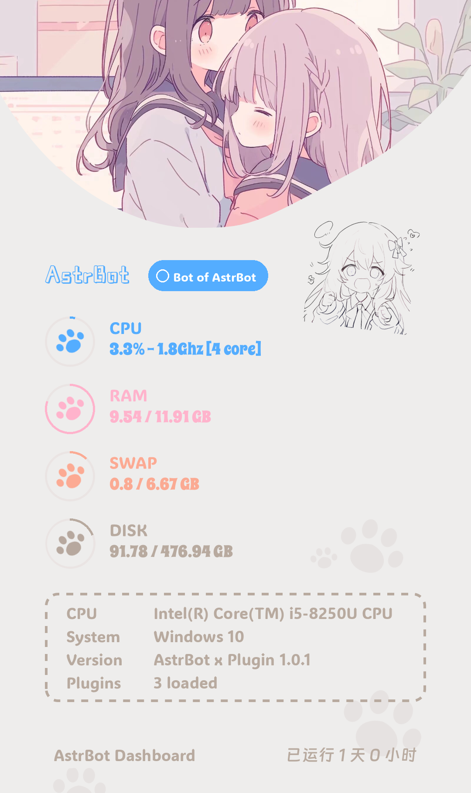

<div align="center">

# 🐾 astrbot-plugin-cute-status

_⭐ 基于 AstrBot 的可爱服务器状态卡片插件 ⭐_

<a href="https://www.python.org/downloads/">
  
</a>
<a href="https://github.com/AstrBotDevs/AstrBot">
  
</a>

<a href="https://github.com/Cvandia/astrbot-plugin-cute-status/blob/main/LICENSE">
  
</a>

**中文简体**

</div>

---

基于 [nonebot-plugin-kawaii-status](https://github.com/KomoriDev/nonebot-plugin-kawaii-status)
的功能设计，为 AstrBot 重新实现的服务器状态查看插件。发送指令即可获得Kawaii 插画状态卡片，
查看 CPU、内存、交换区、磁盘、系统信息、已启用插件数和运行时长。

使用 AstrBot 标准消息组件发送图片，无需 NoneBot、Alconna、浏览器或远程渲染服务。
卡片复用原插件的插画背景、爪印、配色、字体和 1080 × 1814 布局，框架徽标与页脚改为 AstrBot。

## 📖 使用

1. 需要 **Python 3.10+、AstrBot 4.5.0+**；Python 版本还需满足所用 AstrBot 版本的要求。
2. 在 AstrBot WebUI 中安装并启用插件，设置在插件配置面板中修改。
3. 更新记录见 [更新日志](CHANGELOG.md)。

### 📦 安装

在 AstrBot WebUI 的「插件」页面使用「从链接安装」，输入：

```text
https://github.com/Cvandia/astrbot-plugin-cute-status
```

手动安装（在 AstrBot 根目录执行，使用运行 AstrBot 的 Python 环境）：

```bash
git clone https://github.com/Cvandia/astrbot-plugin-cute-status.git data/plugins/astrbot_plugin_cute_status
python -m pip install -r data/plugins/astrbot_plugin_cute_status/requirements.txt
```

重启 AstrBot 或在 WebUI 中重载插件。容器部署时，依赖安装需要在 AstrBot 容器环境内完成。
无需 `nb plugin install`，也无需修改 NoneBot 的配置文件。

### 🎮 指令

| 命令 | 示例 | 默认权限 |
| --- | --- | --- |
| status | `/status` | 所有人 |
| 状态 | `/状态` | 所有人 |
| 运行状态 | `/运行状态` | 所有人 |

命令遵循 AstrBot 的唤醒前缀设置，上表以 `/` 为例。群聊需要 @ 时，请发送 `@机器人 /状态`。
`only_admin` 指 **AstrBot 配置中的管理员**，不直接等同于群主或平台群管理员。
`to_me` 仅限制群聊必须包含对机器人自身的 @，私聊无需 @；不支持 @ 的平台请保持关闭。
插件处理完指令后停止事件传播，避免该消息继续触发默认对话。

### 🖼️ 效果预览

下图由本项目渲染器生成，使用固定示例数据：



### ⚙️ 配置

在 AstrBot WebUI 的插件配置面板中按需设置，保存后重载插件：

| 配置项 | 类型 | 默认值 | 说明 |
| --- | --- | --- | --- |
| `nickname` | string | `AstrBot` | 卡片昵称，最多 64 字符；超出卡片宽度时截断 |
| `only_admin` | bool | `false` | 仅允许 AstrBot 管理员查询 |
| `to_me` | bool | `false` | 群聊必须 @机器人，私聊不受影响 |
| `cooldown` | float | `10.0` | 插件实例共享的查询冷却秒数，0–3600，0 关闭 |
| `disk_path` | string | `/` | 查询此路径所在文件系统，Windows 可设置 `C:\` |
| `font_path` | string | 空字符串 | 自定义字体文件路径，留空使用内置中文字体 |

`disk_path`、`font_path` 的相对路径均以 AstrBot 进程工作目录为基准，建议使用绝对路径。
卡片时间使用 AstrBot 进程所在系统的时区。

### 🔧 与 NoneBot 版的区别

- `status__only_superuser` 对应这里的 `only_admin`；`status__to_me` 对应 `to_me`。
- 配置通过 AstrBot 插件配置面板管理，不读取 NoneBot `.env`。
- 使用 AstrBot `Image` 图片组件，无需 OneBot 专属 API；实际图片展示取决于适配器能力。
- 运行时间是 **AstrBot Python 进程存活时间**，重载插件不会重置；系统开机时长保留在文字降级输出中。
- 不沿用 NoneBot 的依赖、初始化钩子、插件数量统计或渲染模块。

### 🧪 开发验证

```bash
python -m pip install -r requirements-dev.txt
python -m pre_commit install
python -m pre_commit run --all-files
python -m compileall -q .
python -m unittest discover -s tests -v
```

`pre_commit install` 需要在 Git 克隆的仓库中运行；每个本地克隆执行一次，随后提交时会自动检查。
检查包含 Python 导入排序、Ruff 代码检查与格式化、JSON/YAML 语法、合并冲突标记、行尾及空白。
普通新增文件限制为 1 MiB，随插件发布的原版 `.ttf` 字体除外。
自动修正后请检查修改并重新 `git add`、提交。GitHub Actions 也会对全部文件执行同一套检查。
这些工具属于开发依赖，AstrBot 安装插件时仍只使用 `requirements.txt`。

测试覆盖原图插画与爪印保留、零进度不绘制弧线、采集边界、PNG 渲染、配置校验，以及 SDK 替身下的处理器权限、@、冷却、并发和异常分支。
这些测试不代表已在真实 AstrBot 服务或 QQ/Telegram 等平台完成端到端联调。

### ⚠️ 已知限制

- 在 Docker 等隔离环境中，psutil 展示的是当前环境可见的系统信息；不保证等于容器配额，磁盘数据为所选路径所在文件系统。
- CPU 型号通过 `platform.processor()` 获取，部分系统只能显示架构名；无法获取频率时显示 N/A。
- 未配置 Swap 时显示 0 GiB / 0%，不会除零。绘图或字体加载失败时返回文字状态并记录日志。
- 图片发送本身由 AstrBot 平台适配器负责；适配器发送失败需检查 AstrBot 日志。
- 默认使用原插件字体，中文昵称使用钉钉进步体；自定义昵称包含特殊符号或 Emoji 时，建议使用包含对应字形的字体。
- 单次 CPU 采样约 0.5 秒，同时只运行一个采集绘图任务；冷却由各会话共享。

## 💝 特别鸣谢

- [x] [KomoriDev/nonebot-plugin-kawaii-status](https://github.com/KomoriDev/nonebot-plugin-kawaii-status)：原始功能、渲染布局、插画和字体资源来源，保留其 MIT 声明。
- [x] [AstrBot](https://github.com/AstrBotDevs/AstrBot)：机器人框架与插件接口。
- [x] [Pillow](https://github.com/python-pillow/Pillow)、[psutil](https://github.com/giampaolo/psutil)：图片绘制与系统状态采集。
- [x] 原插件随附的 ADLaM Display、Spicy Rice、钉钉进步体及 baotu 字体：沿用原版排版，资源来源见 [资源说明](assets/README.md)。
- [x] [Cvandia/nonebot-plugin-genshin-cos](https://github.com/Cvandia/nonebot-plugin-genshin-cos)：README 结构与排版参考。

### 👥 感谢以下开发者

<a href="https://github.com/Cvandia/astrbot-plugin-cute-status/graphs/contributors">
  
</a>

## 🛠️ 支持

[帮助文档](https://docs.astrbot.app/) · [问题反馈](https://github.com/Cvandia/astrbot-plugin-cute-status/issues) · [更新日志](CHANGELOG.md)

代码使用 MIT，见 [LICENSE](LICENSE)。插画与字体来源见 [资源说明](assets/README.md)。
